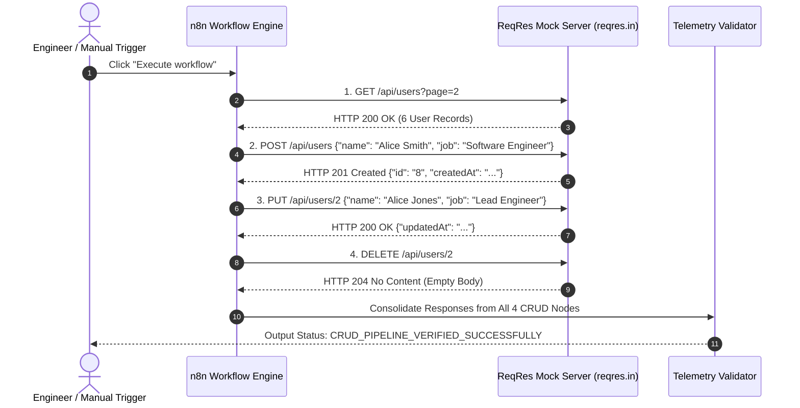

# Topic 2: Making Your First API Calls

> **Institution:** Tayana Academy | LMS Assessment & Hands-On Engineering Guide  
> **Course:** n8n Workflow Automation & API Engineering — Level 1 (Foundations)  
> **Topic / Assessment:** Topic 2: Making Your First API Calls (Step-by-Step Guide)  
> **Workflow Name:** `N8N CRUD Verification Workflow`  
> **Target Audience:** Integration Engineers, Automation Trainees & API Developers  
> **Difficulty Level:** Level 1 (Foundations)  
> **Platform Version:** n8n version 1.0.0 or higher / Postman v10+  
> **Student:** Abhishek Nikam (`abhishek.n@tayanasolutions.com`)  
> **Repository:** [topic-02-making-your-first-api-calls](https://github.com/abhisheknikam3/topic-02-making-your-first-api-calls)  

---

## 1. Executive Summary & Objective

In enterprise systems integration, interacting with RESTful services requires mastering all core HTTP verbs—**GET, POST, PUT, PATCH, and DELETE**—alongside request parameterization, header negotiation, body encoding, and status code interpretation.

### Core Objectives
1. **ReqRes Public Sandbox Exploration:** Understand mock REST API behaviors using [ReqRes](https://reqres.in), an industry-standard mock service providing full CRUD lifecycle simulation.
2. **Query String Parameterization (GET):** Append key-value query parameters (`?page=2`) to filter and paginate server records, verifying `200 OK` responses.
3. **Resource Creation via JSON Payloads (POST):** Structure raw JSON request bodies (`name`, `job`) to create resources, inspecting `201 Created` status codes and server-assigned identifiers (`id`, `createdAt`).
4. **Idempotent Resource Replacement (PUT):** Dispatch complete entity updates to verify `200 OK` status and server modification timestamps (`updatedAt`).
5. **Resource Removal (DELETE):** Transmit removal requests targeting unique resource IDs (`/api/users/2`), validating successful `204 No Content` execution.
6. **Sequential Multi-Verb Workflow Automation:** Construct the unified `N8N CRUD Verification Workflow` combining all CRUD operations with consolidated telemetry validation.

---

## 2. Canvas Architecture & Workflow Topology

### 2.1 ASCII Canvas Architecture

```
[ Manual_Trigger ]
        │
        ▼
[ HTTP_GetUsers_Page2 ]       (GET /api/users?page=2)      -> HTTP 200 OK
        │
        ▼
[ HTTP_Post_CreateUser ]      (POST /api/users)             -> HTTP 201 Created
        │
        ▼
[ HTTP_Put_UpdateUser ]       (PUT /api/users/2)            -> HTTP 200 OK
        │
        ▼
[ HTTP_Delete_User ]          (DELETE /api/users/2)         -> HTTP 204 No Content
        │
        ▼
[ Code_ConsolidateCRUDMetrics ]
(Validates All 4 Verbs: GET, POST, PUT, DELETE in Sequential Flow)
        │
        ▼
Status: CRUD_PIPELINE_VERIFIED_SUCCESSFULLY
```

### 2.2 Mermaid Sequence Diagram



---

## 3. Step-by-Step Practical Build Guide

### Step 1: Understand the ReqRes Sandbox Endpoints
ReqRes is a free, publicly accessible API mock engine:
- **Base URL:** `https://reqres.in`
- **Supported Methods:** `GET`, `POST`, `PUT`, `PATCH`, `DELETE`
- **Header:** `Content-Type: application/json`

### Step 2: Configure Query Parameters (GET Request)
Query parameters append key-value filters to the request URI:
* **Target Endpoint:** `GET https://reqres.in/api/users?page=2`
* **In Postman:**
  1. Open a new tab, select method `GET`, enter `https://reqres.in/api/users`.
  2. Select the **Params** tab; enter Key: `page`, Value: `2`.
  3. URL automatically updates to `https://reqres.in/api/users?page=2`.
  4. Click **Send**; verify status `200 OK`.
* **In n8n:**
  1. Add an `HTTP Request` node named `HTTP_GetUsers_Page2`.
  2. Method: `GET`, URL: `https://reqres.in/api/users`.
  3. Enable **Send Query Parameters**, add Name: `page`, Value: `2`.
  4. Test step; verify 6 users returned on page 2.

### Step 3: Create a Record (POST Request with JSON Body)
POST transmits data payloads to instantiate new resources:
* **Target Endpoint:** `POST https://reqres.in/api/users`
* **JSON Payload:**
  ```json
  {
    "name": "Alice Smith",
    "job": "Software Engineer"
  }
  ```
* **In Postman:**
  1. Method: `POST`, URL: `https://reqres.in/api/users`.
  2. In **Body**, select **raw** and format **JSON**.
  3. Paste the payload; click **Send**.
  4. Status returns `201 Created` with generated `id` and `createdAt`.
* **In n8n:**
  1. Add an `HTTP Request` node named `HTTP_Post_CreateUser`.
  2. Method: `POST`, URL: `https://reqres.in/api/users`.
  3. Enable **Send Body**, Body Content Type: `JSON`, Specify Body: `Using JSON`.
  4. Paste payload; test step; confirm `201 Created`.

### Step 4: Update a Record (PUT Request)
PUT performs complete resource replacement:
* **Target Endpoint:** `PUT https://reqres.in/api/users/2`
* **JSON Payload:**
  ```json
  {
    "name": "Alice Jones",
    "job": "Lead Engineer"
  }
  ```
* **In n8n:**
  1. Add an `HTTP Request` node named `HTTP_Put_UpdateUser`.
  2. Method: `PUT`, URL: `https://reqres.in/api/users/2`.
  3. Send Body: `JSON`, paste the updated payload.
  4. Test step; verify status `200 OK` and `updatedAt` attribute.

### Step 5: Delete a Record (DELETE Request)
DELETE requests server-side resource removal:
* **Target Endpoint:** `DELETE https://reqres.in/api/users/2`
* **In n8n:**
  1. Add an `HTTP Request` node named `HTTP_Delete_User`.
  2. Method: `DELETE`, URL: `https://reqres.in/api/users/2`.
  3. Set `onError: continueRegularOutput` to handle empty body (`204 No Content`) smoothly.
  4. Test step; confirm execution completes with `204 No Content`.

### Step 6: Build and Execute the Combined CRUD Workflow
1. Wire nodes in sequence:
   - `Manual_Trigger` connects to both `HTTP_GetUsers_Page2` (Read) and `HTTP_Post_CreateUser` (Create).
   - `HTTP_Post_CreateUser` connects to `HTTP_Put_UpdateUser` (Update).
   - `HTTP_Put_UpdateUser` connects to `HTTP_Delete_User` (Delete).
   - Both `HTTP_GetUsers_Page2` and `HTTP_Delete_User` connect to `Code_ConsolidateCRUDMetrics`.
2. Rename workflow to: **`N8N CRUD Verification Workflow`**.
3. Save and click **Test workflow**.
4. Confirm all nodes light up green with successful checkmarks.

---

## 4. Node-by-Node Technical Specifications

| Node Name | Node Type | HTTP Method | Target URL | Expected Status | Configuration Highlights |
| :--- | :--- | :--- | :--- | :--- | :--- |
| **Manual_Trigger** | `manualTrigger` | N/A | Canvas Trigger | N/A | One-click execution entry point |
| **HTTP_GetUsers_Page2** | `httpRequest` | `GET` | `https://reqres.in/api/users` | `200 OK` | Query param `page=2` |
| **HTTP_Post_CreateUser** | `httpRequest` | `POST` | `https://reqres.in/api/users` | `201 Created` | JSON body: `Alice Smith` |
| **HTTP_Put_UpdateUser** | `httpRequest` | `PUT` | `https://reqres.in/api/users/2` | `200 OK` | JSON body: `Alice Jones` |
| **HTTP_Delete_User** | `httpRequest` | `DELETE` | `https://reqres.in/api/users/2` | `204 No Content` | Target ID 2 deletion |
| **Code_ConsolidateCRUDMetrics** | `code` | N/A | JavaScript Engine | N/A | Aggregates all 4 verb metrics |

---

## 5. HTTP Methods & Status Codes Master Matrix

| HTTP Verb | Semantic Meaning | Idempotent? | Expected Status | Response Body |
| :--- | :--- | :--- | :--- | :--- |
| **`GET`** | Retrieve resource state | Yes | `200 OK` | JSON object or collection array |
| **`POST`** | Create new subordinate resource | No | `201 Created` | Created entity + generated `id` + timestamp |
| **`PUT`** | Complete replacement of existing resource | Yes | `200 OK` | Updated entity + `updatedAt` timestamp |
| **`PATCH`** | Partial modification of existing resource | No | `200 OK` | Modified entity attributes |
| **`DELETE`** | Remove resource from server | Yes | `204 No Content` | Empty payload / header confirmation |

---

## 6. Postman vs. n8n Configuration Blueprint

| Operational Step | Postman Implementation | n8n Workflow Implementation |
| :--- | :--- | :--- |
| **Query Parameters** | **Params** tab key-value grid (`page` = `2`) | HTTP Request **Send Query Parameters** option |
| **JSON Request Body** | **Body** tab → `raw` radio button → `JSON` dropdown | HTTP Request **Send Body** → `JSON` format |
| **Header Customization** | **Headers** tab key-value rows | HTTP Request **Send Headers** option |
| **Status Code Inspection** | Bottom status pill (`200 OK`, `201 Created`) | Node execution inspector / `$json` output |
| **Chained Execution** | Postman Runner / Newman test scripts | Native visual canvas connections between nodes |

---

## 7. Formatted Telemetry Output Log

```json
{
  "crudWorkflowStatus": "CRUD_PIPELINE_VERIFIED_SUCCESSFULLY",
  "targetSandbox": "ReqRes Mock API (https://reqres.in)",
  "operationsExecuted": {
    "readOperation": {
      "method": "GET",
      "endpoint": "https://reqres.in/api/users?page=2",
      "expectedStatus": 200,
      "pageNumber": 2,
      "recordsReturned": 6,
      "status": "SUCCESS_200_OK"
    },
    "createOperation": {
      "method": "POST",
      "endpoint": "https://reqres.in/api/users",
      "expectedStatus": 201,
      "createdUser": {
        "name": "Alice Smith",
        "job": "Software Engineer",
        "id": "8",
        "createdAt": "2026-11-23T12:46:35.433Z"
      },
      "status": "SUCCESS_201_CREATED"
    },
    "updateOperation": {
      "method": "PUT",
      "endpoint": "https://reqres.in/api/users/2",
      "expectedStatus": 200,
      "updatedUser": {
        "name": "Alice Jones",
        "job": "Lead Engineer",
        "updatedAt": "2026-11-23T12:46:35.753Z"
      },
      "status": "SUCCESS_200_OK"
    },
    "deleteOperation": {
      "method": "DELETE",
      "endpoint": "https://reqres.in/api/users/2",
      "expectedStatus": 204,
      "status": "SUCCESS_204_NO_CONTENT",
      "resourceRemoved": true
    }
  },
  "verifiedAt": "2026-11-23T12:46:36.000Z",
  "allOperationsPassed": true
}
```

---

## 8. LMS Assessor Submission Text

```text
Student Name: Abhishek Nikam
Student Email: abhishek.n@tayanasolutions.com
Course: n8n Workflow Automation & API Engineering — Level 1 (Foundations)
Topic: Topic 2: Making Your First API Calls (Step-by-Step Guide)
Workflow Name: N8N CRUD Verification Workflow
GitHub Repository: https://github.com/abhisheknikam3/topic-02-making-your-first-api-calls

Assessment Deliverables Included:
1. Topic_02_Making_Your_First_API_Calls.json:
   - Full n8n workflow named "N8N CRUD Verification Workflow" featuring Manual_Trigger, HTTP_GetUsers_Page2, HTTP_Post_CreateUser, HTTP_Put_UpdateUser, HTTP_Delete_User, and Code_ConsolidateCRUDMetrics.
   - Pre-pinned execution data for all CRUD methods (GET 200, POST 201, PUT 200, DELETE 204).
   - Validates query parameters, raw JSON bodies, headers, and status code handling.
2. README.md:
   - Complete technical blueprint covering ReqRes sandbox endpoints, HTTP CRUD verbs, Postman and n8n build steps, status code master matrix, and verification logs.
3. README.pdf:
   - Formatted PDF compilation of the implementation guide generated via Playwright.
```
